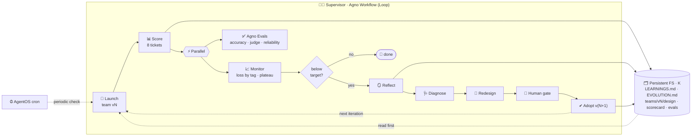
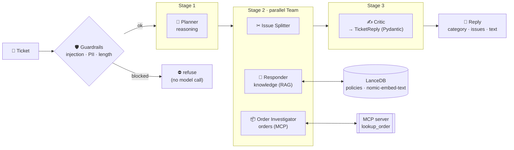
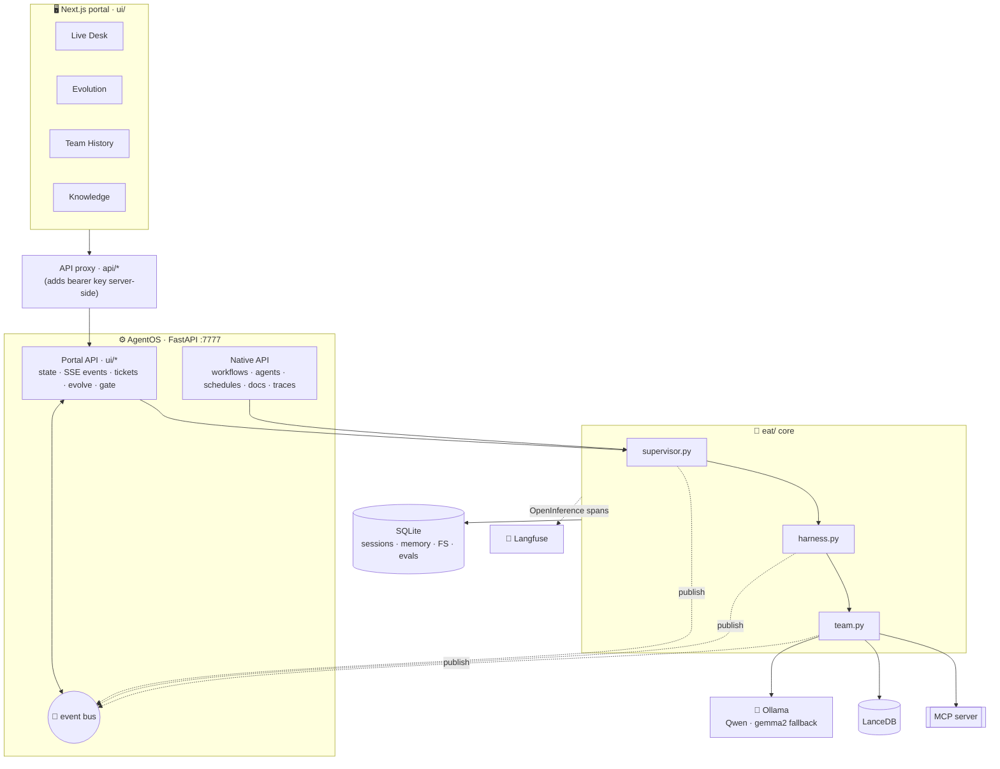

<div align="center">



# 🧬 Evolving Support Team

**A self-evolving multi-agent team that diagnoses its own failures, invents new roles, and rebuilds itself.**

Built only on the [Agno](https://docs.agno.com) SDK · runs 100% locally on Ollama + Qwen · live Next.js portal


*After "Evolving Agent Teams" (Cao, Mao, Li, Gonzalez, Stoica, UC Berkeley, arXiv 2610.36848)*

[Quick start](#-quick-start) · [Architecture](#-architecture) · [Live portal](#-live-portal) · [Results](#-results) · [Docs](docs/)

</div>

---

## ✨ What it does

A **supervisor** watches a support team's score on real tickets. When the score is stuck, it:

| 🔍 Diagnoses | 🧠 Redesigns | 🙋 Asks | 📚 Remembers |
|---|---|---|---|
| finds *why* the team fails (missing policy facts, no order access, wrong routing, local optimum) | invents new roles and picks a coordination shape: **solo · pipeline · parallel** | a human approves, edits or rejects each new team | writes lessons to a **persistent file system** every later team reads first |

Use case: customer-support tickets (refunds, shipping, damage, billing, warranty, account, plus one prompt-injection attack), scored per team version.
Why this use case: [docs/PRD.md](docs/PRD.md). Full 21-component map: [docs/ARCHITECTURE.md](docs/ARCHITECTURE.md).

---

## 🏗 Architecture



<sub>42 components · 30 live data flows. Regenerate with `uv run python docs/assets/gen_architecture.py docs/assets/architecture.svg`.</sub>

### The evolution loop (paper figure 2 → Agno)



### Inside one team version

`TeamDesign` is **data**, not code: the Designer writes a new one and `eat/team.py` turns it into Agno agents.
One role in a stage → `Agent`. Several roles in a stage → `Team(mode=broadcast)` (parallel).



*v1 is only Planner → Responder → Critic. Issue Splitter and Order Investigator are roles the supervisor **invented** in later versions.*

### System view



### Paper → implementation

| Paper concept | Here |
|---|---|
| Team **T = (Roles, Coordination, Knowledge)** | `TeamDesign(stages, roles, reads)` in [eat/schemas.py](eat/schemas.py) |
| Supervisor loop | Agno `Workflow` → `Loop`, `Parallel`, `Condition` in [eat/supervisor.py](eat/supervisor.py) |
| Persistent knowledge K | `agno.fs.FileSystem` in [eat/fs.py](eat/fs.py) |
| Invented roles | Designer agent outputs a validated `TeamDesign` (version = current + 1) |
| Local-optimum detection | `plateaued()` in [eat/harness.py](eat/harness.py) → Designer adds a *Challenger* |
| Triggers: team finish + periodic | every loop pass + AgentOS `ScheduleManager` cron |
| Matched-budget ablation | [eat/demo.py](eat/demo.py): evolving vs fixed 3-role vs solo |

---

## 🚀 Quick start

```bash
# 1. tools: uv (https://docs.astral.sh/uv/) + Ollama (https://ollama.com) + Node 20+ for the portal
ollama pull qwen3.5-4b-16k      # main model   (override with EAT_MODEL)
ollama pull nomic-embed-text    # the one embedder
ollama pull gemma2:9b           # optional fallback

# 2. project
uv sync
cp .env.example .env            # optional: Langfuse keys, OS_SECURITY_KEY, EAT_MODEL
```

### ▶ Run

| What | Command | Time |
|---|---|---|
| ✅ Smoke test (no Ollama) | `uv run python -m tests.test_smoke` → `OK [0.794, 0.869, 0.942, 1.0]` | seconds |
| 🧪 Real Qwen demo + ablation | `uv run python -m eat.demo` | 30–60+ min |
| 🙋 Same, you approve each redesign | `uv run python -m eat.demo --approve ask` | 30–60+ min |
| ⚙ AgentOS API + scheduler | `uv run python -m eat.os_app` → http://localhost:7777/docs | server |
| 🖥 Live portal | see below | server |

> 💡 `EAT_OFFLINE=1` swaps Ollama for a deterministic rule-based simulator (`eat/offline.py`). It is for tests and fast UI demos: it proves the wiring, **not** model quality.

---

## 🖥 Live portal

Watch each agent work on your request, and watch the team evolve, live.

```bash
# terminal 1: backend
uv run python -m eat.os_app                  # real Qwen
EAT_OFFLINE=1 uv run python -m eat.os_app    # or: instant simulator, good for a first look

# terminal 2: portal
cd ui && npm install && npm run dev          # http://localhost:3000
```

| Screen | You see |
|---|---|
| **Live Desk** | submit a ticket → agents light up stage by stage, tool calls (knowledge search, order lookup via MCP, reasoning) stream in, final structured reply + score |
| **Evolution** | start a run → Launch → Score → Monitor → Reflect → Diagnose → Redesign → **approve / reject in the UI** → Adopt |
| **Team History** | score per version, team lineage with invented roles, evals, failure tags |
| **Knowledge** | `LEARNINGS.md` and `EVOLUTION.md` from the persistent file system |

Portal API (`/ui/*`, bearer `OS_SECURITY_KEY` when set): `GET state` · `GET events` (SSE) · `POST tickets` · `POST evolve` · `POST gate`.

AgentOS native API examples:

```bash
curl -H "Authorization: Bearer $KEY" -F message=go -F background=true -F stream=false localhost:7777/workflows/evolving-supervisor/runs   # background run
curl -N -H "Authorization: Bearer $KEY" -F message=go localhost:7777/workflows/evolving-supervisor/runs                                   # streamed events
curl -H "Authorization: Bearer $KEY" localhost:7777/schedules                                                                            # the cron "supervisor-check"
```

---

## 📊 Results

**Offline simulator** (wiring proof): 0.794 → 0.869 → 0.942 → **1.0** over 4 versions; fixed teams stay at 0.794.

**Real local Qwen** (`qwen3.5-4b-16k`, one run, 5 versions): **the evolving team did not beat the fixed baseline.**

| ver | score | team change |
|-----|-------|------|
| v1 | 0.685 | Planner → Responder → Critic |
| v2 | 0.612 | + Issue Splitter (parallel with Responder) |
| v3 | 0.583 | + Order Investigator |
| v4 | 0.598 | + Policy Validator |
| v5 | 0.677 | + Challenger |

Matched budget (1.70M tokens): evolving **0.685** · fixed 3-role **0.715** · solo **0.312**. Agno evals pass (reliability PASSED, judge 5–10/10), so failures are score-level, not crashes.

**Reading:** the loop runs end to end (diagnose, invent roles, adopt, learn) and the Designer proposes sensible roles, but a 4B model does not turn extra parallel roles into better replies. Broadcast Teams add noise and token cost (74k → 1.7M), and the substring score is noisy at 8 tickets. The paper used much stronger models. To retest, set `EAT_MODEL` to a larger Qwen.

---

## 🗂 Project structure

```
eat/
  schemas.py        Pydantic contracts: TicketReply, TeamDesign, ScoreCard, Reflection, Diagnosis
  config.py         Ollama models + fallback, SQLite, LanceDB knowledge, one embedder, .env loader
  fs.py             persistent file system K (agno.fs.FileSystem)
  team.py           TeamDesign → Agents / Teams, solves a ticket
  harness.py        seed team, scoring, failure tags, plateau detection
  supervisor.py     the supervisor Workflow (the paper's core loop)
  evals.py          Agno Accuracy / Reliability / AgentAsJudge evals
  guards.py         guardrails + pre/post hooks + token meter
  mcp_server.py     custom MCP server (lookup_order)
  events.py         live event bus (tool hooks, stages, supervisor phases)
  ui_api.py         /ui/* portal API: state, SSE, tickets, evolve, gate
  observability.py  OpenInference → Agno DB + Langfuse
  os_app.py         AgentOS runtime (API, auth, scheduler)
  demo.py           matched-budget ablation
  offline.py        test-only simulator
ui/                 Next.js live portal
data/               policy docs (RAG) + tickets
docs/               PRD.md, ARCHITECTURE.md
tests/test_smoke.py
runs/               generated: sqlite, lancedb, logs (git-ignored)
```

---

## 🔭 Observability

Every agent, team, workflow step, model call and tool call is an **OpenInference** span. Spans always land in the Agno database (AgentOS "Traces").
Set `LANGFUSE_PUBLIC_KEY`, `LANGFUSE_SECRET_KEY` and `LANGFUSE_HOST` (e.g. `https://us.cloud.langfuse.com`) and the same spans also go to **Langfuse** over OTLP.

---

## ⚖ Honest limits

- Scores are single runs; the paper reports best of two. Small local models are noisy.
- Fact coverage is a substring heuristic (tolerant of `30-day` vs `30 days`), not a semantic judge.
- Token budgets come from Ollama's reported usage; fixed baselines are capped at 3 re-runs.
- One supervisor run per namespace at a time; keep `EAT_CHECK_CRON` longer than a full run.
- The Reflector learns from the scored tickets (no held-out split), so scores are in-sample.
- The portal event stream is in-memory: a server restart clears the live feed (history stays in the DB).
