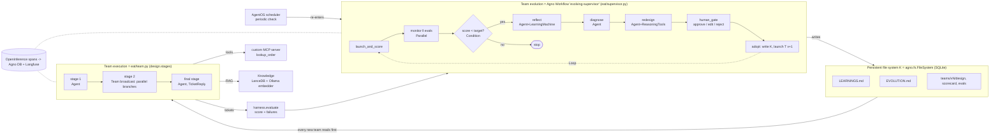

# Architecture

## Paper figure 2 -> this implementation

| Paper element | Here |
|---|---|
| Supervisor (Monitor, Reflect, Redesign, Launch) | `Supervisor.workflow()`: Loop > Step / Parallel / Condition |
| Trigger: team finished | each Loop pass starts with `launch_and_score` |
| Trigger: periodic cron | `ScheduleManager.create(...)` in `os_app.py`, AgentOS poller calls the workflow |
| Roles R | `TeamDesign.roles` (`RoleSpec`), invented by the Designer agent |
| Coordination Pi | `TeamDesign.stages`: 1 role = Agent, many roles = Team(broadcast); solo / pipeline / parallel / mixed |
| Knowledge management M | `TeamDesign.reads` + `LEARNINGS.md` rules injected into every agent |
| File system K | `eat/fs.py` over `agno.fs.FileSystem` |
| Score per version / plateau | `harness.evaluate`, `harness.plateaued` |
| Fixed-team ablation | `eat/demo.py`: fixed 3-role + solo at matched token budget |

## 21 components -> Agno feature

| # | Component | Where | Agno feature |
|---|---|---|---|
| 1 | Supervisor loop | `supervisor.py` | `Workflow`, `Loop`, `Step`, `Parallel`, `Condition` |
| 2 | Dynamic roles + coordination | `schemas.TeamDesign`, `team.py` | `Agent` per role, `Team(mode=broadcast)` per parallel stage |
| 3 | Persistent file system | `fs.py` | `agno.fs.FileSystem` (database backend) |
| 4 | Evaluation harness | `harness.py` | scoring + plateau detection |
| 5 | Agent / Team / Workflow | `team.py`, `supervisor.py` | Agent = role, Team = parallel group, Workflow = supervisor |
| 6 | Models + fallback | `config.py` | `Ollama` Qwen, `fallback_models=[Ollama gemma2]` |
| 7 | Tools + MCP | `mcp_server.py`, `team.py` | custom `MCPServer` (stdio) consumed by `MCPTools(server_params=StdioServerParameters)` |
| 8 | ReAct | `team.py`, `supervisor.py` | `ReasoningTools`, tool loops, `tool_call_limit` |
| 9 | Storage + sessions | `config.get_db` | `SqliteDb`, per-customer `user_id`, per-stage `session_id`, history |
| 10 | Memory | `team.py` | `add_history_to_context` (short term), `enable_agentic_memory` (long term) |
| 11 | State | `supervisor.py`, `team.py` | workflow `session_state`, agent `session_state` |
| 12 | Context management | `team.py` | `compress_tool_results`, compact stage hand-off, top-1 RAG |
| 13 | Knowledge / RAG | `config.get_knowledge` | `Knowledge`, `LanceDb`, `OllamaEmbedder` |
| 14 | Learning | `supervisor.py` | `LearningMachine(learned_knowledge)`, plus `LEARNINGS.md` |
| 15 | Guardrails | `guards.py` | `PromptInjectionGuardrail`, `PIIDetectionGuardrail`, size check, `tool_call_limit` |
| 16 | Hooks | `guards.py` | `pre_hooks`, `post_hooks` (token metering) |
| 17 | Structured output | `schemas.py` | `output_schema` (Pydantic) |
| 18 | Human in the loop | `supervisor.human_gate` | approve / edit / reject before a team is adopted (`--approve ask`) |
| 19 | Evals | `evals.py`, `supervisor.evals` | `AccuracyEval`, `ReliabilityEval`, `AgentAsJudgeEval`, stored in the Agno DB, run in the workflow next to the monitor |
| 20 | Observability | `observability.py` | `setup_tracing` + OpenInference, extra OTLP sink to Langfuse |
| 21 | Runtime | `os_app.py` | `AgentOS`, streaming, `background=true`, `ScheduleManager`, `OS_SECURITY_KEY` |
